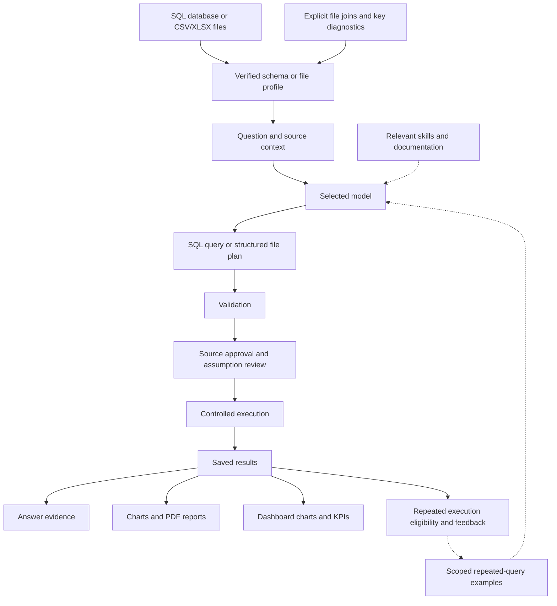

<p align="center">
  
</p>

<p align="center">
  
  
  
  
  
  
</p>

# DataPilot

### Agentic Data Analytics Workbench

DataPilot brings questions, queries, results, dashboards, and reports into one workspace. Connect a SQL database, load a CSV/XLSX file, or join several files; ask a question in plain English; review the proposed analysis; and explore the answer through tables, charts, KPI cards, and PDF reports.

Each saved answer includes evidence of how it was calculated. SQL and file operations pass validation, execution starts behind approval, and sessions retain results and history on disk. Repeated successful queries can supply examples for future analyses, with feedback and controls to disable or clear learning. Use an installed Ollama model or explicitly choose a cloud provider.

[Quick start](#quick-start) · [Features](#features) · [Multi-file joins](#multi-file-joins) · [Answer evidence](#answer-evidence) · [Dashboards](#dashboards) · [Repeated-query learning](#repeated-query-learning) · [Configuration](#configuration) · [Verification](#verification)

The `develop` branch includes multi-file joins, answer evidence, persistent dashboards, and repeated-query learning. The latest recorded regression is **156 passed, 15 skipped**; see [Verification](#verification) for coverage and unavailable live services.

## Workbench preview

This is the starting screen: I create a new analysis from the sidebar or reopen a recent session.


## Features

| Area | What I can do |
| --- | --- |
| Natural-language analysis | Ask questions against SQL databases and CSV/XLSX files. |
| Database connections | Configure SQLite, PostgreSQL, or MySQL sources. Live verification coverage is listed below. |
| SQL workflow | Review generated SQL, approve execution, and use bounded, revalidated repair retries. |
| File workflow | Turn analytical plans into validated Pandas filter, select, groupby, sort, and limit operations. |
| Model selection | Use Ollama, OpenAI, Anthropic, DeepSeek, Qwen, or a custom OpenAI-compatible HTTPS endpoint. |
| SQL knowledge | Load concise examples from easy, mid, hard, and dialect-specific references when generation or repair needs them. |
| Documentation | Retrieve official documentation through Tavily for local models, or the selected cloud provider's supported native search. |
| Persistent sessions | Reopen results, restore workflow checkpoints, and reconstruct compacted conversation history. |
| Visualizations | Generate Matplotlib/Seaborn PNG charts and Plotly/Bokeh interactive HTML charts. |
| Reports | Export a result, its question, executed analysis, and associated PNG charts as a PDF. |
| Multi-file joins | Combine two to eight CSV/XLSX files with explicit keys, relationship checks, unmatched-row diagnostics, and bounded output. |
| Answer evidence | Inspect the executed calculation and filters, planning explanation, assumptions, source fingerprints, model, row counts, and truncation. |
| Dashboards | Pin saved charts and KPI cards, apply shared result filters, reorder/remove cards, and explicitly refresh their analyses. |
| Repeated-query learning | Reuse repeated successful execution examples within a session/source/model scope, with feedback, an opt-out, and a forget control. |

## Quick start

### Prerequisites

- Python **3.13 or newer**.
- [uv](https://docs.astral.sh/uv/) for the locked project environment.
- Either a running Ollama instance with a suitable installed model, or credentials and an explicit model identifier for a cloud provider.

### Install and run

```powershell
git clone --branch develop https://github.com/AbdullahPoet/DataPilot.git
cd DataPilot
uv sync --locked
uv run --locked python app.py
```

Alternatively, activate the environment and use the project entry point directly:

```powershell
.\.venv\Scripts\Activate.ps1
python app.py
```

For a local headless server:

```powershell
uv run --locked python app.py --server.headless=true --server.address=127.0.0.1
```

Open the local URL printed by Streamlit.

### Run an analysis

1. Select **New Analytics**.
2. Choose a database connection, load a CSV/XLSX file, or select **Combine multiple files** in a file session.
3. Configure and save the model for that session.
4. Ask a question, such as “What is the total amount by region?”
5. Review the generated SQL or file operation plan and approve or reject it.
6. Open **Answer evidence** to inspect the calculation, assumptions, source version, and returned row count.
7. Generate a chart, pin charts or KPIs to the session dashboard, or export a PDF report.

Approval covers subsequent validated, read-only analyses of the same source in that session. Changed file contents, join configuration, or database schema produce a new source version and require fresh approval. Plans with model-reported assumptions also require review. A rejected request remains rejected. Pending approvals must resume with the original source and model endpoint.

## Multi-file joins

Combine files such as `orders.csv` and `customers.xlsx` to answer questions about orders by customer region.

1. Create or reopen a CSV or XLSX session and select **Combine multiple files**.
2. Upload two to eight CSV/XLSX files, or enter local paths, one per line. Mixed file types are supported.
3. Choose a worksheet for each workbook and a unique alias for each source, such as `orders` and `customers`.
4. For each additional file, select its join keys, a **left** or **inner** join, and the expected relationship: many-to-one, one-to-one, one-to-many, or many-to-many.
5. Review the duplicate-key counts, unmatched rows, output counts, and preview, then select **Save joined data source**.

Files join in the displayed order using one key per pair. Columns use qualified names such as `orders.amount` and `customers.region`. Null keys never match. Many-to-many relationships require explicit selection because they can multiply rows and amounts. Relationship checks reject unexpected duplicate keys, and output size is checked before merging. Each input and intermediate join is limited to 1,000,000 rows.

File contents, worksheets, aliases, and join choices form the source version. Changing any of them requires fresh approval before analytical execution.

## Answer evidence

Open **Answer evidence** below a saved result to inspect:

- The original question and the model's planning explanation and assumptions.
- The executed SQL or structured file operations, including filters and aggregations.
- Source fingerprints, file row counts, and join diagnostics where applicable.
- The model/provider, execution attempts, returned row count, and truncation status.

Treat the model explanation as something to check against the executed calculation. SQL evidence records a schema fingerprint; live database contents are not saved as a reproducible source snapshot. Older results may lack detailed evidence.

Plans with model-reported assumptions require review even after source approval. Reject incorrect assumptions and ask again, using **Definitions or clarification** to specify meanings such as whether “revenue” includes discounts. The app cannot guarantee detection of every ambiguous question.

## Dashboards

Build a persistent dashboard inside each analytics session:

1. Open **Pin KPI to dashboard** below a result. Choose a title and calculation: sum, mean, minimum, maximum, or count. Numeric calculations require a numeric column; count counts saved result rows.
2. To pin a chart, create it, open **Saved charts**, and select **Pin chart to dashboard**. Older chart artifacts without a saved visualization plan must be recreated first.
3. Use **Move up** or **Remove card** to arrange up to 24 cards.
4. Under **Shared filters**, select a column common to all card results, choose values, optionally include missing values, and select **Apply shared filter**. Use **Clear shared filters** to reset them.

Cards calculate from saved results. Shared equality filters compare displayed string values and act **after aggregation**; they do not change the underlying SQL or file plan. Cards using truncated results display a warning because their values may be incomplete.

### Refresh and recovery

Select **Refresh dashboard analyses** to rerun each distinct pinned question against the currently configured source and model. Questions shared by several cards run once. Refresh uses the normal validation and approval safeguards; reconnect SQL sources first.

A pending approval pauses the persisted refresh queue, which can resume after an application restart. Rejecting approval, a failed analysis, or an incompatible result stops the queue and retains that question's previous cards. Earlier completed questions may already have updated their cards. **Cancel dashboard refresh** cancels queued work; any pending analytical approval must still be approved or rejected separately.

## Repeated-query learning

DataPilot learns from repeated queries by saving successful execution examples locally. Learning is enabled by default per session. After **two distinct, successful, non-truncated executions** of the same question and exact SQL/file operations, that example becomes eligible as bounded context for the repeated question. Only whitespace is normalized; paraphrases and changed parameters do not automatically match.

Examples remain isolated by session, source version, schema/profile, provider, model identifier, and endpoint. Every new request still generates and validates a plan, applies approval rules, and executes against current data. Execution success alone does not establish analytical correctness, and this feature does not update model weights or promote examples into verified skills.

| Control | Behavior |
| --- | --- |
| **Learn from successful repeated queries** | Disable to stop both recording and reuse for the session. |
| **Useful analysis** | Record positive feedback for an eligible saved example. |
| **Incorrect analysis — exclude from learning** | Exclude that question/plan example from future learning. |
| **Forget learned examples** | Remove the session's learned examples while preserving results. Replay receipts prevent old checkpoints from immediately relearning them. |

Feedback controls appear on results with a recorded learning example. Model-generated Python is never executed. When using a cloud model, eligible examples become part of the context sent to the selected provider.

## Configuration

### SQL database connections

Select **New Analytics → SQL → Create Analytics Session**, then choose the **Database type**.

| Database | What to enter |
| --- | --- |
| SQLite | The full path to an existing database file, such as `D:\Data\sales.db`. No username or password is needed. |
| PostgreSQL | Host (`localhost` or the server address), port (default `5432`), database name, username, and password. |
| MySQL | Host (`localhost` or the server address), port (default `3306`), database name, username, and password. |

Example values for the connection form (replace them with your own database details):

| Field | SQLite | PostgreSQL | MySQL |
| --- | --- | --- | --- |
| Database type | `SQLite` | `PostgreSQL` | `MySQL` |
| Existing database file path | `D:\Data\sales.db` | Not applicable | Not applicable |
| Host | Not applicable | `localhost` | `localhost` |
| Port | Not applicable | `5432` | `3306` |
| Database name | Not applicable | `sales_db` | `sales_db` |
| Username | Not applicable | `analytics_reader` | `analytics_reader` |
| Password | Not applicable | Your account password | Your account password |

The SQLite file must already exist. For PostgreSQL/MySQL, `sales_db` and the `analytics_reader` account must already exist, with permission to read the tables; DataPilot does not create them.

Click **Connect and load schema**. Once the connection succeeds, configure and save a model to start asking questions. PostgreSQL/MySQL servers must be running and reachable; use an account with read-only access to the required tables. After restarting DataPilot, reconnect to resume database execution.

### Local models

DataPilot discovers installed models from the configured Ollama endpoint, initially `http://localhost:11434`. I start Ollama and install models separately; the app does neither automatically.

The local configuration I verified is:

| Setting | Value |
| --- | --- |
| Model | `qwen3.5:4b` |
| Context window | 35,000 tokens |
| Reasoning | Disabled |
| Request timeout | 180 seconds |

DataPilot requires a configured context window of at least 35,000 tokens and checks the model's advertised maximum. Reasoning controls appear for models that support them. Request timeouts are configurable from 1 to 600 seconds. Other models may still fail to produce the required structured responses within the output budget.

### Cloud models and documentation search

Set credentials in the process environment or a local `.env` file. Model identifiers are entered explicitly in the UI.

| Service | Environment variable | Purpose |
| --- | --- | --- |
| OpenAI | `OPENAI_API_KEY` | Cloud inference |
| Anthropic | `ANTHROPIC_API_KEY` | Cloud inference |
| DeepSeek | `DEEPSEEK_API_KEY` | Cloud inference |
| Qwen | `DASHSCOPE_API_KEY` | Cloud inference |
| Custom OpenAI-compatible endpoint | `CUSTOM_LLM_API_KEY` | Cloud inference |
| Tavily | `TAVILY_API_KEY` | Documentation search and extraction for local models |

For example, a local `.env` can contain:

```dotenv
TAVILY_API_KEY=your_tavily_api_key
```

The repository ignores `.env`. I keep real credentials out of source control.

Documentation retrieval runs when the model requests it. Local-model retrieval uses Tavily search and direct page fetching, with Tavily extraction as a fallback when fetching fails. Sources are restricted to official documentation domains, with redirect and response-size checks. Cloud retrieval uses only the selected provider's supported native search; unavailable or unconfirmed searches are reported explicitly. DataPilot does not silently switch providers.

### Data and storage

| Path | Contents |
| --- | --- |
| `storage/app.db` | Sessions, approvals, result references, answer evidence, conversation memory, dashboard cards/filters/refresh queues, learning examples/preferences, and replay receipts |
| `storage/checkpoints.db` | LangGraph workflow checkpoints |
| `sessions/<session_id>/` | Uploaded single/joined source files, checksummed results, and chart artifacts with saved visualization plans |
| `storage/reports/<session_id>/` | Generated PDF reports |
| `storage/logs/<session_id>/` | Successful SQL execution logs |
| `skills/` | Shared SQL references and isolated model-family skills |

Set `DATAPILOT_HOME` to use a separate application working directory. That directory must contain `skills/`; runtime storage and session directories are created there.

Local-first refers to application storage and the option to run inference locally. Selecting a cloud model sends questions, source schemas or file profiles, selected skills, relevant analytical history, and eligible repeated-query examples to that provider. Documentation queries and requested page URLs are sent to the search service when used. Database passwords remain in the active Streamlit session and are not persisted in application configuration or checkpoints. After restarting, reconnect to resume database execution; saved artifacts and dashboards remain available.

## How it works



I use LangGraph to coordinate the workflow and SQLite checkpoints to restore its state, including pending approvals. Older conversation history is compacted in bounded batches and reconstructed with summaries, recent turns, and result references. Context accounting uses a conservative UTF-8 estimate; requests that exceed the budget fail explicitly.

SQL references live in `skills/easy`, `skills/mid`, `skills/hard`, and `skills/dialects`. Legacy `skills/medium` is also supported. The agent can use direct Markdown references and nested `SKILL.md` files. Model-family skills are loaded only for the selected family. See the [SQL reference catalog](skills/README.md).

### Execution safeguards

- SQLite opens existing databases read-only with query-only enforcement and a deadline. PostgreSQL and MySQL use read-only transactions; I also use a dedicated read-only database account.
- SQL validation rejects multiple statements, writes, file access, extension loading, and unverified functions. Some valid SQL may be rejected conservatively.
- SQL repair is limited to three attempts. Every repaired query is validated again; connection, permission, and timeout errors do not trigger speculative repair.
- File plans compile to allowlisted operations. DataPilot never executes arbitrary model-generated Python.
- Results, approvals, reports, and memory are scoped to their session and source identity. Truncated results are marked in the UI and reports.
- Joins enforce selected key relationships and reject excessive output before merging. File changes are checked before execution and result storage.
- Model-reported assumptions require explicit review. Pending approvals remain bound to the original source and model endpoint.
- Learning supplies scoped examples to planning; it never bypasses validation, approval, or execution. Negative feedback excludes examples, and replay receipts preserve the effect of forgetting them.
- Dashboard refresh keeps prior cards when that question fails, is rejected, or produces incompatible data.

## Verification

I keep offline regression checks separate from live service checks. Fixture-based model tests establish integration behavior; they do not establish a real model's capabilities.

The latest recorded `develop` regression ran on **October 18, 2026**: **156 passed, 15 skipped**. Skips require live services or credentials; Ollama was unreachable during that run. Earlier live evidence is dated separately below.

| Coverage | Verified scope |
| --- | --- |
| Offline/application regression — October 18 | **156 passed, 15 skipped**, including SQL security, chart/PDF generation, and the real application server health check. |
| New workbench features — October 18 | Mixed CSV/XLSX joins, evidence restoration, learning isolation/feedback/forgetting, assumption review, dashboard filters/pinning/refresh/recovery, and Streamlit interactions passed with fixture model responses and real downstream execution. |
| Packaging and dependencies — October 18 | Ruff, dependency compatibility, lockfile validation, wheel/source builds, and imports of all packaged backend modules passed. |
| Real local-model analytics — October 17 | SQL, CSV, and XLSX workflows passed with `qwen3.5:4b`. New workbench features have not been verified with a live model in the October 18 run. |
| Live documentation — October 17 | Five live Tavily/Qwen checks passed: search, extraction, SQLite/Pandas retrieval, and model-triggered retrieval. The combined documentation run was **19 passed**. |
| Cloud models and external databases | Real cloud inference/native search and PostgreSQL/MySQL analytical workflows remain unverified in this environment. |

Run the standard checks:

```powershell
uv run --locked ruff check src app.py streamlit_app.py tests
uv run --locked pytest -q -rs
uv pip check
uv lock --check
uv build
```

For a focused run covering the new workbench features and application/UI integration:

```powershell
uv run --locked pytest tests/test_workbench_features.py tests/test_application.py tests/test_streamlit.py -q
```

For real Ollama integration checks, select an installed model:

```powershell
$env:DATAPILOT_TEST_OLLAMA_MODEL = 'qwen3.5:4b'
$env:DATAPILOT_TEST_REQUEST_TIMEOUT = '180'
uv run --locked pytest tests/test_external_integrations.py -q -rs
```

For live documentation checks, configure `TAVILY_API_KEY` and optionally `DATAPILOT_TEST_OLLAMA_MODEL`:

```powershell
uv run --locked pytest tests/test_live_documentation.py tests/test_documentation.py -q -rs
```

Cloud checks require the provider credential and its matching explicit test model variable: `DATAPILOT_TEST_OPENAI_MODEL`, `DATAPILOT_TEST_ANTHROPIC_MODEL`, `DATAPILOT_TEST_DEEPSEEK_MODEL`, or `DATAPILOT_TEST_QWEN_MODEL`.

Database checks accept `DATAPILOT_TEST_POSTGRES_URL` (`postgresql+psycopg://...`) or `DATAPILOT_TEST_MYSQL_URL` (`mysql+pymysql://...`). Those external checks run `SELECT 1`; a successful connection check does not replace an analytical workflow test for a deployment.

Feature details and limits are recorded in the [workbench feature delivery](docs/WORKBENCH_FEATURES.md); earlier backend and live-service evidence is in the [implementation audit](docs/IMPLEMENTATION_AUDIT.md).

## Project structure

```text
DataPilot/
├── app.py                 # Application launcher
├── streamlit_app.py       # Streamlit entry point
├── src/datapilot/
│   ├── agents/            # Analysis planning and structured generation
│   ├── ingestion/         # File loading, profiling, and bounded joins
│   ├── models/            # Model adapters and configuration
│   ├── persistence/       # Sessions, results, evidence, and dashboards
│   ├── skills_engine/     # Skills, SQL fallback, and repeated-query examples
│   ├── tools/             # Documentation retrieval and search
│   └── ui/                # Configuration, joins, evidence, and dashboard UI
├── skills/                # SQL references and model-family knowledge
├── tests/                 # Regression, security, UI, and live checks
├── docs/                  # Audit, changed-file manifest, and README images
├── pyproject.toml         # Package metadata and dependencies
└── uv.lock                # Locked dependency resolution
```

## Current limits

I currently treat DataPilot as a local workbench. Multi-user authentication, remote deployment isolation, and a complete dependency vulnerability audit are outside the verified release scope.

| Area | Current boundary |
| --- | --- |
| File analysis | Filter, select, groupby, sort, and limit operations with allowlisted aggregations. |
| Joins | Two to eight CSV/XLSX files; left/inner joins; one key per pair; at most 1,000,000 rows per input/intermediate result. Database-to-file joins are not provided by this feature. |
| Dashboards | Up to 24 cards per session. Shared filters act on saved result rows after aggregation. Refresh is explicit and can partially complete across distinct questions. |
| Evidence | SQL fingerprints schemas rather than database contents. Ambiguity review depends on model-reported assumptions and user clarification. Older artifacts may lack evidence or visualization plans. |
| Learning | Reuses exact repeated-question/plan examples within a session/source/model scope. No model-weight training, automatic paraphrase matching, or independently established answer correctness. |
| PDF reports | At most 10 columns, 100 preview rows by default, and 12 associated PNG/JPEG charts. Interactive HTML charts remain separate downloads; full multilingual typography is unverified. |
| External integrations | New features have offline integration coverage; live model behavior and external database deployments require their own verification. |

## Contributing

Issues with a small reproducible example are welcome. For code changes, keep the scope focused, run Ruff and the relevant tests, and distinguish live-service results from mocked checks. Remove credentials and private data from examples and logs before sharing them.
