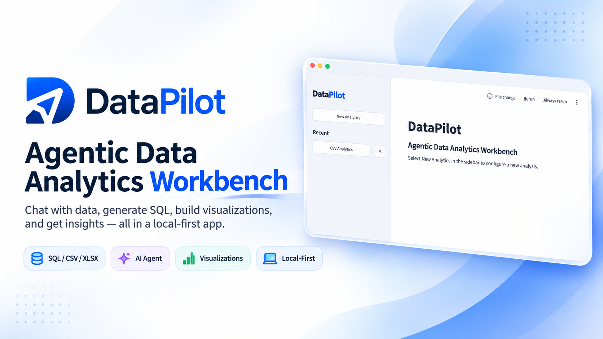
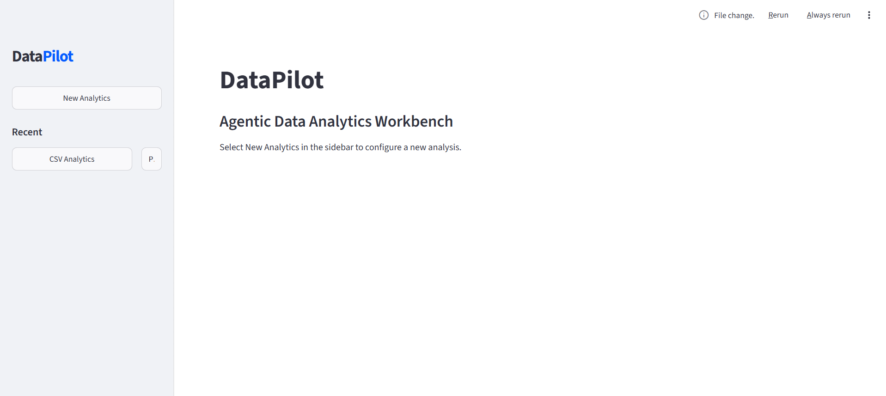
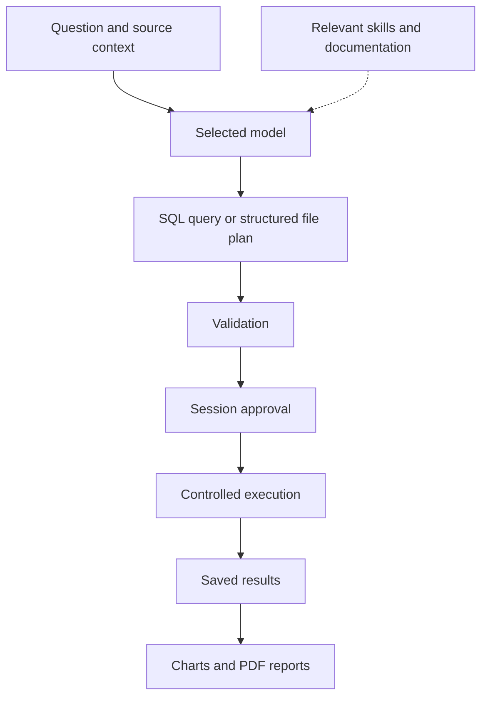

<p align="center">
  
</p>

<p align="center">
  
  
  
  
  
  
</p>

# DataPilot

### Agentic Data Analytics Workbench

I built DataPilot to bring questions, queries, results, and reports into one workspace. I can connect a SQL database or load a CSV/XLSX file, ask a question in plain English, review the proposed analysis, and turn the result into a chart or PDF report.

My focus is on keeping the analysis inspectable: generated SQL and file operations go through validation, execution starts behind an approval step, and sessions keep their results and history on disk. I can use an installed Ollama model or explicitly choose a cloud provider.

[Quick start](#quick-start) · [Features](#features) · [Configuration](#configuration) · [How it works](#how-it-works) · [Verification](#verification) · [Project structure](#project-structure)

## Workbench preview

This is the starting screen: I create a new analysis from the sidebar or reopen a recent session.



## Features

| Area | What I can do |
| --- | --- |
| Natural-language analysis | Ask questions against SQL databases and CSV/XLSX files. |
| Database connections | Configure SQLite, PostgreSQL, or MySQL sources. Live verification coverage is listed below. |
| SQL workflow | Review generated SQL, approve execution, and use bounded, revalidated repair retries. |
| File workflow | Turn analytical plans into validated Pandas filter, select, groupby, sort, and limit operations. |
| Model selection | Use Ollama, OpenAI, Anthropic, DeepSeek, Qwen, or a custom OpenAI-compatible HTTPS endpoint. |
| SQL knowledge | Load concise examples from easy, mid, hard, and dialect-specific references when generation or repair needs them. |
| Documentation | Retrieve official documentation through Tavily for local models, or the selected cloud provider's supported native search. |
| Persistent sessions | Reopen results, restore workflow checkpoints, and reconstruct compacted conversation history. |
| Visualizations | Generate Matplotlib/Seaborn PNG charts and Plotly/Bokeh interactive HTML charts. |
| Reports | Export a result, its question, executed analysis, and associated PNG charts as a PDF. |
| Multi-file joins | Combine two to eight CSV/XLSX files with explicit keys, relationship checks, unmatched-row diagnostics, and bounded output. |
| Answer evidence | Inspect the executed calculation and filters, planning explanation, assumptions, source fingerprints, model, row counts, and truncation. |
| Dashboards | Pin saved charts and KPI cards, apply shared result filters, reorder/remove cards, and explicitly refresh their analyses. |
| Repeated-query learning | Reuse repeated successful execution examples within a session/source/model scope, with feedback, an opt-out, and a forget control. |

## Quick start

### Prerequisites

- Python **3.13 or newer**.
- [uv](https://docs.astral.sh/uv/) for the locked project environment.
- Either a running Ollama instance with a suitable installed model, or credentials and an explicit model identifier for a cloud provider.

### Install and run

```powershell
git clone --branch develop https://github.com/AbdullahPoet/DataPilot.git
cd DataPilot
uv sync --locked
uv run --locked python app.py
```

Alternatively, activate the environment and use the project entry point directly:

```powershell
.\.venv\Scripts\Activate.ps1
python app.py
```

For a local headless server:

```powershell
uv run --locked python app.py --server.headless=true --server.address=127.0.0.1
```

Open the local URL printed by Streamlit.

### Run an analysis

1. Select **New Analytics**.
2. Choose a database connection or load a CSV/XLSX file.
3. Configure and save the model for that session.
4. Ask a question, such as “What is the total amount by region?”
5. Review the generated SQL or file operation plan and approve or reject it.
6. Explore the result, generate a chart, or export a PDF report.

Approval covers subsequent validated, read-only analyses of the same source in that session. Changed file contents require fresh approval. A rejected request remains rejected.

### Combine files, inspect evidence, and build a dashboard

In a CSV or XLSX session, select **Combine multiple files**. Upload mixed CSV/XLSX files or enter local paths, choose a worksheet for each workbook, and give each source a unique alias. Files join in the displayed order using one key per pair. Choose a left or inner join and the expected key relationship. Review duplicate keys, unmatched rows, output counts, and the preview, then select **Save joined data source**. Columns are qualified as `orders.amount` or `customers.region`. Null keys never match; many-to-many relationships must be selected explicitly. Each input and intermediate join is limited to 1,000,000 rows. File contents, worksheets, aliases, and join choices form the source version and its approval boundary.

Open **Answer evidence** below a saved result to inspect its question, executed SQL or file operations, model explanation, assumptions, source version, and returned row count. SQL evidence records a schema fingerprint; database rows remain live rather than a reproducible database snapshot. Plans with model-reported assumptions require review even after the source was approved. Reject incorrect assumptions and ask again, using **Definitions or clarification** to specify business meanings. The app cannot guarantee detection of every ambiguous question. Older results may have no detailed evidence.

Use **Pin KPI to dashboard** to choose a numeric aggregation or a count of saved result rows. Create a chart, open **Saved charts**, and select **Pin chart to dashboard**. Cards persist in the session and support reordering and removal. Shared equality filters apply to columns common to all card results, comparing their displayed string values, with an explicit missing-value option. Filters act after the underlying analysis and aggregation; they do not change its SQL or file plan. Truncated inputs to cards are labeled.

**Refresh dashboard analyses** reruns each distinct pinned question against the currently configured source and model, keeping existing validation and approval safeguards. Questions shared by several cards run once. A pending approval pauses the saved refresh queue, which can resume after an application restart. Rejecting approval or a failed analysis stops the queue and retains that question's previous cards. Earlier completed questions in the same refresh may already have updated their cards. Reconnect SQL sources before refreshing. **Cancel dashboard refresh** cancels queued work; any pending analytical approval must still be approved or rejected separately.

### Learning from repeated queries

Learning is enabled by default per session. After two distinct, successful, non-truncated executions of the same question and exact SQL/file operations, the example becomes eligible as bounded context for that repeated question. Only whitespace is normalized. Examples are isolated by session, source version, schema/profile, provider, model identifier, and endpoint. Each request still generates and validates a plan, applies approval rules, and executes against current data.

This is local example retrieval, not model-weight training or automatic promotion into verified skills. Execution success does not establish analytical correctness. Mark an analysis **Incorrect** to exclude its example, or **Useful** to update its feedback. **Forget learned examples** removes the session's examples without deleting results or allowing checkpoint replay to relearn old results. Disable learning to stop both recording and reuse. Model-generated Python is never executed. With a cloud model, eligible examples become part of the context sent to that selected provider.

## Configuration

### SQL database connections

Select **New Analytics → SQL → Create Analytics Session**, then choose the **Database type**.

| Database | What to enter |
| --- | --- |
| SQLite | The full path to an existing database file, such as `D:\Data\sales.db`. No username or password is needed. |
| PostgreSQL | Host (`localhost` or the server address), port (default `5432`), database name, username, and password. |
| MySQL | Host (`localhost` or the server address), port (default `3306`), database name, username, and password. |

Example values for the connection form (replace them with your own database details):

| Field | SQLite | PostgreSQL | MySQL |
| --- | --- | --- | --- |
| Database type | `SQLite` | `PostgreSQL` | `MySQL` |
| Existing database file path | `D:\Data\sales.db` | Not applicable | Not applicable |
| Host | Not applicable | `localhost` | `localhost` |
| Port | Not applicable | `5432` | `3306` |
| Database name | Not applicable | `sales_db` | `sales_db` |
| Username | Not applicable | `analytics_reader` | `analytics_reader` |
| Password | Not applicable | Your account password | Your account password |

The SQLite file must already exist. For PostgreSQL/MySQL, `sales_db` and the `analytics_reader` account must already exist, with permission to read the tables; DataPilot does not create them.

Click **Connect and load schema**. Once the connection succeeds, configure and save a model to start asking questions. PostgreSQL/MySQL servers must be running and reachable; use an account with read-only access to the required tables. After restarting DataPilot, reconnect to resume database execution.

### Local models

DataPilot discovers installed models from the configured Ollama endpoint, initially `http://localhost:11434`. I start Ollama and install models separately; the app does neither automatically.

The local configuration I verified is:

| Setting | Value |
| --- | --- |
| Model | `qwen3.5:4b` |
| Context window | 35,000 tokens |
| Reasoning | Disabled |
| Request timeout | 180 seconds |

DataPilot requires a configured context window of at least 35,000 tokens and checks the model's advertised maximum. Reasoning controls appear for models that support them. Request timeouts are configurable from 1 to 600 seconds. Other models may still fail to produce the required structured responses within the output budget.

### Cloud models and documentation search

Set credentials in the process environment or a local `.env` file. Model identifiers are entered explicitly in the UI.

| Service | Environment variable | Purpose |
| --- | --- | --- |
| OpenAI | `OPENAI_API_KEY` | Cloud inference |
| Anthropic | `ANTHROPIC_API_KEY` | Cloud inference |
| DeepSeek | `DEEPSEEK_API_KEY` | Cloud inference |
| Qwen | `DASHSCOPE_API_KEY` | Cloud inference |
| Custom OpenAI-compatible endpoint | `CUSTOM_LLM_API_KEY` | Cloud inference |
| Tavily | `TAVILY_API_KEY` | Documentation search and extraction for local models |

For example, a local `.env` can contain:

```dotenv
TAVILY_API_KEY=your_tavily_api_key
```

The repository ignores `.env`. I keep real credentials out of source control.

Documentation retrieval runs when the model requests it. Local-model retrieval uses Tavily search and direct page fetching, with Tavily extraction as a fallback when fetching fails. Sources are restricted to official documentation domains, with redirect and response-size checks. Cloud retrieval uses only the selected provider's supported native search; unavailable or unconfirmed searches are reported explicitly. DataPilot does not silently switch providers.

### Data and storage

| Path | Contents |
| --- | --- |
| `storage/app.db` | Sessions, approvals, result references, and conversation memory |
| `storage/checkpoints.db` | LangGraph workflow checkpoints |
| `sessions/<session_id>/` | Uploaded sources, checksummed result files, and chart artifacts |
| `storage/reports/<session_id>/` | Generated PDF reports |
| `storage/logs/<session_id>/` | Successful SQL execution logs |
| `skills/` | Shared SQL references and isolated model-family skills |

Set `DATAPILOT_HOME` to use a separate application working directory. That directory must contain `skills/`; runtime storage and session directories are created there.

Local-first refers to application storage and the option to run inference locally. Selecting a cloud model sends questions, source schemas or file profiles, selected skills, and relevant analytical history to that provider. Documentation queries and requested page URLs are sent to the search service when used. Database passwords remain in the active Streamlit session and are not persisted in application configuration or checkpoints. After restarting, reconnect to resume database execution; saved artifacts remain available.

## How it works



I use LangGraph to coordinate the workflow and SQLite checkpoints to restore its state, including pending approvals. Older conversation history is compacted in bounded batches and reconstructed with summaries, recent turns, and result references. Context accounting uses a conservative UTF-8 estimate; requests that exceed the budget fail explicitly.

SQL references live in `skills/easy`, `skills/mid`, `skills/hard`, and `skills/dialects`. Legacy `skills/medium` is also supported. The agent can use direct Markdown references and nested `SKILL.md` files. Model-family skills are loaded only for the selected family. See the [SQL reference catalog](skills/README.md).

### Execution safeguards

- SQLite opens existing databases read-only with query-only enforcement and a deadline. PostgreSQL and MySQL use read-only transactions; I also use a dedicated read-only database account.
- SQL validation rejects multiple statements, writes, file access, extension loading, and unverified functions. Some valid SQL may be rejected conservatively.
- SQL repair is limited to three attempts. Every repaired query is validated again; connection, permission, and timeout errors do not trigger speculative repair.
- File plans compile to allowlisted operations. DataPilot never executes arbitrary model-generated Python.
- Results, approvals, reports, and memory are scoped to their session and source identity. Truncated results are marked in the UI and reports.

## Verification

I keep offline regression checks separate from live service checks. Fixture-based model tests establish integration behavior; they do not establish a real model's capabilities.

The October 18, 2026 `develop` feature regression reports **156 passed, 15 skipped**. Ruff, installed-package compatibility, lockfile validation, packaged-module imports, wheel/source builds, and the application health check pass. The skips require live services or credentials; Ollama was unreachable during this run. See the [workbench feature delivery](docs/WORKBENCH_FEATURES.md) for joins, evidence, dashboards, learning, and their boundaries. The table below preserves the earlier live verification evidence.

The results below reflect verification on October 17, 2026.

| Coverage | Verified scope |
| --- | --- |
| Offline/application regression | Latest full run: **134 passed, 15 skipped**; the skipped checks require opt-in live-service configuration. |
| Real local-model analytics | SQL, CSV, and XLSX workflows passed with `qwen3.5:4b`. |
| Live documentation | All five live Tavily/Qwen checks passed: search, extraction, SQLite/Pandas retrieval, and model-triggered retrieval. The combined documentation run was **19 passed**. |
| Latest sidebar change | Both existing Streamlit interaction tests and Ruff passed. |
| Cloud models and external databases | Real cloud inference/native search and PostgreSQL/MySQL analytical workflows remain unverified in this environment. |

Run the standard checks:

```powershell
uv run --locked ruff check src app.py streamlit_app.py tests
uv run --locked pytest -q -rs
uv pip check
uv build
```

For real Ollama integration checks, select an installed model:

```powershell
$env:DATAPILOT_TEST_OLLAMA_MODEL = 'qwen3.5:4b'
$env:DATAPILOT_TEST_REQUEST_TIMEOUT = '180'
uv run --locked pytest tests/test_external_integrations.py -q -rs
```

For live documentation checks, configure `TAVILY_API_KEY` and optionally `DATAPILOT_TEST_OLLAMA_MODEL`:

```powershell
uv run --locked pytest tests/test_live_documentation.py tests/test_documentation.py -q -rs
```

Cloud checks require the provider credential and its matching explicit test model variable: `DATAPILOT_TEST_OPENAI_MODEL`, `DATAPILOT_TEST_ANTHROPIC_MODEL`, `DATAPILOT_TEST_DEEPSEEK_MODEL`, or `DATAPILOT_TEST_QWEN_MODEL`.

Database checks accept `DATAPILOT_TEST_POSTGRES_URL` (`postgresql+psycopg://...`) or `DATAPILOT_TEST_MYSQL_URL` (`mysql+pymysql://...`). Those external checks run `SELECT 1`; a successful connection check does not replace an analytical workflow test for a deployment.

Full evidence and remaining limitations are recorded in the [implementation audit](docs/IMPLEMENTATION_AUDIT.md).

## Project structure

```text
DataPilot/
├── app.py                 # Application launcher
├── streamlit_app.py       # Streamlit entry point
├── src/datapilot/
│   ├── agents/            # Analysis planning and structured generation
│   ├── models/            # Model adapters and configuration
│   ├── persistence/       # Session storage and result restoration
│   ├── skills_engine/     # Skill selection and SQL knowledge fallback
│   ├── tools/             # Documentation retrieval and search
│   └── ui/                # Sidebar, configuration, and analysis workspace
├── skills/                # SQL references and model-family knowledge
├── tests/                 # Regression, security, UI, and live checks
├── docs/                  # Audit, changed-file manifest, and README images
├── pyproject.toml         # Package metadata and dependencies
└── uv.lock                # Locked dependency resolution
```

## Current limits

I currently treat DataPilot as a local workbench. Multi-user authentication, remote deployment isolation, and a complete dependency vulnerability audit are outside the verified release scope.

File analysis is limited to the supported operation vocabulary. PDF previews support up to 10 columns, default to 100 rows, and embed at most 12 associated PNG/JPEG charts. Interactive HTML charts are separate downloads. Default report fonts do not establish full multilingual typography support.

## Contributing

Issues with a small reproducible example are welcome. For code changes, keep the scope focused, run Ruff and the relevant tests, and distinguish live-service results from mocked checks. Remove credentials and private data from examples and logs before sharing them.
